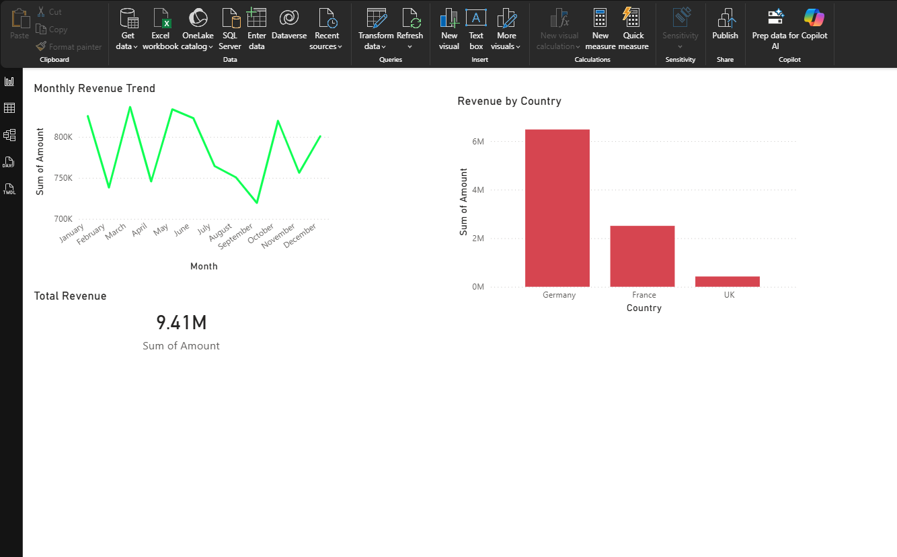
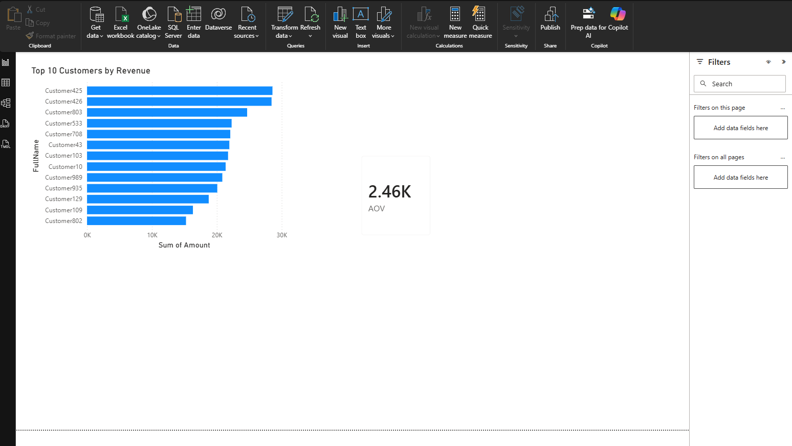
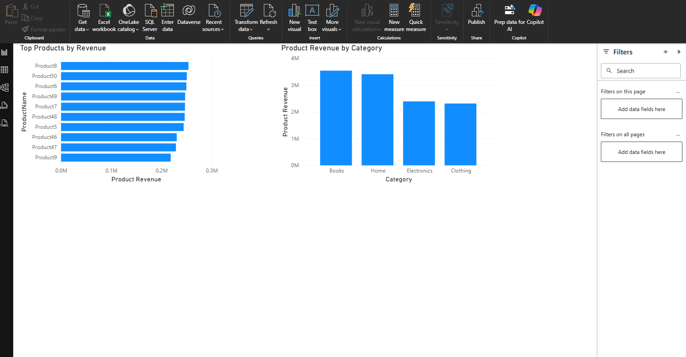

# Sales Performance & Customer Insights - SQL Server Project

## 1. Project Overview
An end-to-end sales analytics project in SQL Server for a simulated online retailer
(customers, products, orders, order items, payments), with a Power BI dashboard on top.

It covers the full workflow: **database design → realistic data generation → data quality checks →
indexing → reusable views → business analysis → parameterised reports → dashboard.**

---

## 2. Business Questions
**Core KPIs** (`05_analysis_queries.sql`)
1. Monthly revenue trend
2. Top 10 customers by lifetime value
3. Repeat customers and repeat rate
4. Average order value (AOV)
5. Top products by revenue
6. Revenue and share by category and by country
7. New customers per month
8. Customer ranking - overall, within each country, and by value quartile

**Advanced analysis** (`06_advanced_analysis.sql`)
1. Month-over-month and year-over-year growth, running total, 3-month moving average (`LAG`, window frames)
2. **RFM segmentation** - Champions, Loyal, At Risk, Lost, … (`NTILE`)
3. **Cohort retention matrix** - % of each month's new customers who buy again in month 1-6
4. **Market basket analysis** - products bought together, with support, confidence and lift
5. **Pareto (80/20)** - how concentrated revenue is across customers
6. Churn - customers inactive for 90+ days, by country
7. Cancellation rate by month and by category, with lost revenue
8. Payment methods - mix, average payment, days to pay
9. New vs returning customer revenue per month
10. Sales by weekday (using the `DimDate` calendar)

---

## 3. Database Schema

```
Customers 1───* Orders 1───* OrderItems *───1 Products
                  │
                  1
                  │
                  0..1 Payments          DimDate (calendar for Power BI)
```

| Table | Columns | Rules |
|---|---|---|
| **Customers** | CustomerID, FullName, Email, Country, CreatedAt | Email unique |
| **Products** | ProductID, ProductName, Category, Price | Price > 0 |
| **Orders** | OrderID, CustomerID, OrderDate, Status | Status ∈ Completed / Cancelled |
| **OrderItems** | OrderItemID, OrderID, ProductID, Quantity, UnitPrice | Quantity > 0, one line per product per order |
| **Payments** | PaymentID, OrderID, Amount, PaymentDate, Method | One payment per completed order |
| **DimDate** | Date, Year, Quarter, Month, MonthStart, YearMonth, DayOfWeek, IsWeekend | |

**Revenue rule:** only *completed* orders count as revenue, in every query and view.

---

## 4. Dataset
Generated by `02_sample_data.sql` - set-based T-SQL, runs in seconds. Two years: **Jan 2024 - Dec 2025**.

| Table | Rows (approx.) |
|---|---|
| Customers | 2,000 |
| Products | 40 (5 categories) |
| Orders | ~4,300 |
| OrderItems | ~11,000 |
| Payments | ~3,800 |

The generator builds in realistic patterns for the analysis to find:
- a growing customer base and a **holiday peak** every November-December
- 85% of sign-ups buy within two weeks; a loyal core comes back repeatedly
- best-selling products, 10% discounts on some order lines, ~12% cancellations
- products **frequently bought together** (e.g. Laptop + Laptop Sleeve, Coffee Maker + Coffee Beans)

Values are random, so your exact numbers will differ slightly on each run.

---

## 5. How to Run
**Requirements:** SQL Server 2016 SP1 or newer (Express / Developer edition is fine) and SSMS or Azure Data Studio.

Run the scripts in `sql/` in order:

| Script | What it does |
|---|---|
| `00_create_database.sql` | Creates `SalesDB` |
| `01_schema.sql` | Tables, keys, constraints, calendar table |
| `02_sample_data.sql` | Generates the data |
| `03_indexes.sql` | Supporting indexes |
| `04_views.sql` | Reusable views (also used by Power BI) |
| `05_analysis_queries.sql` | Core KPI queries |
| `06_advanced_analysis.sql` | Growth, RFM, cohorts, basket, Pareto, churn… |
| `07_stored_procedures.sql` | Parameterised reports |
| `08_data_quality_checks.sql` | 8 checks - all should return **OK** |

Or open `run_all.sql`, switch on **Query → SQLCMD Mode**, set the folder path at the top and press F5.

Example reports:
```sql
EXEC dbo.usp_SalesSummary  @StartDate = '2025-01-01', @EndDate = '2025-12-31';
EXEC dbo.usp_TopCustomers  @TopN = 5, @Country = N'France';
EXEC dbo.usp_CustomerProfile @CustomerID = 42;
```

---

## 6. Views

| View | Purpose |
|---|---|
| `vw_OrderSummary` | One row per order: totals, payment, days to pay, first-order flag (main Power BI fact table) |
| `vw_MonthlyRevenue` | Revenue, orders, active customers, AOV per month |
| `vw_CustomerLifetimeValue` | Orders, lifetime value, first/last order per customer |
| `vw_CategoryRevenue` | Revenue and units per category |
| `vw_CustomerRFM` | RFM scores and segment per customer |
| `vw_CohortRetention` | Retention % by cohort month and months since first order |

---

## 7. Key Findings
*(Fill in after running the scripts on your database.)*

- Revenue grew **__%** from 2024 to 2025, with a holiday peak in December.
- **__** of revenue comes from the top 20% of customers.
- **Champions** are __% of customers but generate __% of revenue; __ customers are **At Risk**.
- On average __% of new customers buy again in their first month.
- Laptop + Laptop Sleeve are bought together **__×** more often than chance (lift).
- Electronics bring __% of revenue; the cancellation rate is __%.

---

## 8. Power BI Dashboard
Connect Power BI to `SalesDB` and load the views above plus `DimDate`
(relationship: `DimDate[Date]` → `vw_OrderSummary[OrderDate]`).

Pages:
- **Revenue overview** - monthly trend, MoM %, revenue by country, KPI cards
- **Customer insights** - top customers, RFM segments, cohort retention heatmap
- **Product performance** - top products, category share, products bought together

### Dashboard Preview




---

## 9. Performance
See [`docs/performance_tuning.md`](docs/performance_tuning.md) for the indexes and how their effect was measured.

---

## 10. Skills Demonstrated
Relational modelling and constraints · set-based T-SQL data generation · joins and aggregation ·
CTEs · window functions (`LAG`, `RANK`, `NTILE`, running totals, moving averages) ·
cohort and RFM analysis · market basket analysis · views and stored procedures ·
indexing and execution plans · data quality checks · Power BI
